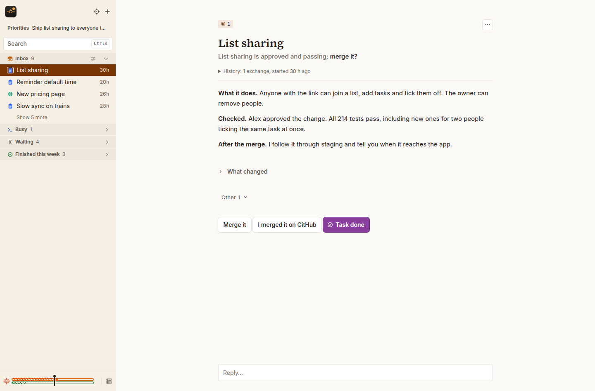

<p align="center"></p>

# Cockpit

**[Try the live demo](https://try-cockpit.pages.dev)** in your browser, with nothing to install.

Cockpit is an inbox for one person directing many Claude Code and Codex sessions.
You never choose which session to check on, and you never sit watching one work.
Each session carries its task on its own and comes to you only when it needs you:
a decision, an approval, a reply. It arrives as a short card with everything you
need to answer, already prepared: what the agent did, what it found, the options
and its recommendation. You answer with one press or a sentence, and your answer
goes back to the session doing the work.

A sweeper session does the triage for you. It picks up new asks from your sources
and checks each waiting card against live state, such as a pull request's reviews,
to find what needs your attention now and to drop what went stale. It orders your inbox by the priorities you write on the page in plain
words, such as "Ship the new checkout before the sale", and keeps at most four cards
there, the most important first. You can still change the order: snooze a card until
later, raise or lower a task's priority, or send a card back to its agent with a
message. Everything else sits below the inbox: under Busy while agents work, and
under Waiting while it depends on a person, a review or a set time.



The same list holds GitHub pull requests, Linear tickets and Slack threads beside
the agent conversations. Agents update it through the `cockpit` command.

Cockpit started as an internal project at [Keeper](https://keeper.ai), and was
later open sourced. It runs on your machine as a Python server with a SQLite
database and a browser interface. Local sign-in is the default for a laptop.
Google OAuth is available for an HTTPS deployment.

## What it does

- **Items** track pieces of work, their state, priority and next move.
- **Steps** are the inbox cards: each asks for an action you can take now, such as
  decide, approve, reply or finish. You see at most four at once.
- **Priorities** are your goals in plain words; the queue is ranked by them.
- A **sweeper** is an agent session that checks waiting cards against live state,
  orders your inbox by your priorities and asks each owning session to prepare its
  next step.
- **Snooze** moves a card out of the inbox until a time you pick; it comes back on
  its own.
- Session conversations, permission requests and structured questions appear on
  the page. You can answer without switching to a terminal.
- Sessions can share HTML reports and images on an item. Spec and skill pages let
  you read, comment on and edit the instructions behind the work.

Slack, Linear and other connected sources require tools available to your agent.
Cockpit reports unavailable sources rather than treating them as checked.

## Install and run locally

You need Python 3.12, Git, [uv](https://docs.astral.sh/uv/), and a signed-in
[Codex CLI](https://developers.openai.com/codex/cli/) or Claude Code installation.
On Linux you also need a systemd user manager: Cockpit starts each `claude`
command, and each agent run it launches itself, in its own scope with
`systemd-run --user`. Check it with `systemctl --user status`; on a server you
log in to over SSH, run `loginctl enable-linger "$USER"` once so the user
manager keeps running. macOS does not need it.
For pull request tracking and other GitHub features, install the
[GitHub CLI](https://cli.github.com/) and run `gh auth login` before starting Cockpit.
The browser assets are included; running Cockpit needs no frontend build.
The checkout's `.python-version` selects the tested Python 3.12 series for `uv`.

Clone this repository, then open its folder. The Spec and Skills pages commit
your edits and push them to the checkout's `origin`, and `cockpit deploy` pushes
the branch it installs there too, so clone a fork you can push to, or point
`origin` at one. Without a writable `origin`, page edits stay committed in the
checkout with the failed push reported, and `cockpit deploy` stops before it
installs anything. From the fresh checkout:

```bash
uv sync --extra test
.venv/bin/cockpit setup --local --provider codex --name Sam --timezone UTC
.venv/bin/cockpit-server
```

Leave the server running. In a second terminal in the same checkout:

```bash
.venv/bin/cockpit login
```

The page opens at `http://127.0.0.1:8790`. Use `--provider claude` during setup to
choose Claude Code instead. Setup creates `~/.config/cockpit/setup.toml` and
preserves an existing setup by refusing to overwrite it. Its paths refer to this
checkout, including the bundled Cockpit skill.

Add the checkout's `.venv/bin` directory to your PATH so agent sessions can invoke
`cockpit`. For example, from the checkout:

```bash
export PATH="$PWD/.venv/bin:$PATH"
```

Make the same directory available in the environment that starts Cockpit and your
agents. Install or link `src/cockpit/skills/cockpit`, `src/cockpit/skills/writing-style` and
`src/cockpit/skills/sign-in-links` into your agent's skills directory so it can load the bundled instructions. For Claude Code, the usual location is
`~/.claude/skills/cockpit`; for Codex, it is `~/.codex/skills/cockpit`.

Setup enables the selected provider. Edit `providers` and `default_provider` in
`setup.toml` to enable both. The example configuration explains each setting:
[docs/setup.example.toml](docs/setup.example.toml).

Local sign-in uses a private login token to obtain a short-lived, one-time browser
code over loopback. The browser receives a session cookie; agents use a separate
API token. Local mode accepts only the configured loopback origin. Use Google
OAuth with HTTPS for remote access. See [docs/LOCAL.md](docs/LOCAL.md) for details.

On macOS, `cockpit service install` installs and starts a per-user LaunchAgent;
`cockpit service status`, `start` and `stop` manage it. For a service installation,
use a dedicated environment as described in [docs/LOCAL.md](docs/LOCAL.md).
On Linux, run `cockpit-server` in the foreground or configure your own user service.
Cockpit and its agents can work only while the host is awake and online.

Claude sessions and `cockpit attach` run in tmux, so install it first (`brew install tmux` on macOS).
Claude usage meters also work when the default `~/.claude` login is held in the macOS Keychain.

## Use agent sessions

The new-session menu selects an enabled provider. A new session starts in the
`checkouts` folder of your setup file or in a git checkout directly inside it. A local
setup sets that folder to the one holding Cockpit's own checkout. From a terminal,
with a checkout `app` in that folder:

```bash
cockpit send --new-in <checkouts folder>/app --provider codex --as helper "Work on this task"
```

Cockpit controls Codex threads it starts through `codex app-server`, using the CLI's
existing login. It starts and resumes threads with the `workspace-write` sandbox
and `on-request` approvals. New sessions use the first model in
`config.SESSION_OPTIONS` for their provider, at high effort: Opus 5.5 for Claude
and Sol for Codex. The new-session menu can override model and effort; saved
threads keep those choices. Cockpit supplies these defaults rather than using
the CLI's default model.

An independent local worker keeps active Codex work and approval requests running
through web-server restarts. Other terminal or desktop conversations can appear
in usage views, but Cockpit controls only its registered threads. Losing the worker
or rebooting interrupts active work. When Cockpit cannot tell whether Codex received
a message, check whether its requested work started or completed before retrying.
The restart test covers Linux with a fake Codex process; the macOS launchd path
still needs a live check.

Claude permission prompts reach Cockpit through two hooks in your Claude Code
settings. Add these entries to the existing `hooks` object, preserving other hooks:

```json
{
  "PermissionRequest": [{"hooks": [{"type": "command", "command": "cockpit permission ask --as permission-hook", "timeout": 1800}]}],
  "PermissionDenied": [{"hooks": [{"type": "command", "command": "cockpit permission report --as permission-hook", "timeout": 10}]}]
}
```

Claude permission rules and generated explanations are specific to Claude. Codex
approval and question cards appear directly on Cockpit.

Permission explanations include your optional `~/AGENTS.md` instructions when that
file exists. Cockpit works without this file.

`cockpit-standing-rules` is an optional installer for Claude Code settings. It adds
allow rules for Cockpit commands without file arguments, Git status, GitHub pull
request reads, Linear reads and comments, and Slack reads. It also installs a hook that checks
GitHub posts, Linear comments and Slack posts for agent attribution and refuses Artifact
publishes, directing shared HTML to `cockpit page`. It preserves other settings
and saves a backup before its first change. Run it only if you want these rules:

```bash
cockpit-standing-rules
```

## Create work with the CLI

With the server running and `cockpit` on PATH, create an item, add a step, and read
back the item and its steps. `--as` records the agent name on each write.

```bash
cockpit item put --as helper <<'JSON'
{"key":"note:list-sharing","title":"List sharing","summary":"Ready to try sharing a Tasks list","stage":"review"}
JSON
cockpit step put --as helper <<'JSON'
{"item_key":"note:list-sharing","need":"review","ask":"Share the Tasks list?","why":"The sharing tests pass","answers":["Share it","Revise it"]}
JSON
cockpit item get note:list-sharing
```

## What this version assumes

Starting the server starts background workers that can launch the sweeper and a
projects tidy-up session when due, using your Claude or Codex subscription.
`providers` and `default_provider` in `setup.toml` choose the available provider
and the default for new sessions. The sweeper can start work sessions to prepare
steps when the queue runs low. There is no setup switch to disable these workers;
sweeps pause while you are away and resume when you return or request an update.

Account discovery supports at most two Claude folders (`~/.claude` and
`~/.claude-work`, `config.ACCOUNTS`) and two Codex folders (`~/.codex` and
`~/.codex-2`, `config.CODEX_HOMES`). A single account works; these folder lists
are defined in code.

An item can wait until its pull requests reach a release branch. Cockpit checks
branches named `dev`, `staging` and `prod`, then wakes the item's session when the
condition holds. These branch names are defined in `stages.py` and `wakes.py`.

Claude usage estimates use a fixed reference to a $200 monthly plan: one week is
$2,400 at API list prices (`spend.WEEK_LIST_USD`), and one percentage point of a
week is $0.50 at the plan price (`spend.PLAN_USD_PER_PERCENT`). These are estimates,
separate from the account's reported limits. Codex uses its own reported weekly
limits.

## Claude usage meters

Claude Code passes subscription limits to its
[status-line command](https://code.claude.com/docs/en/statusline#rate-limit-usage).
The small [capture script](docs/claude-statusline.py) saves them for Cockpit in
`~/.claude/rate-limits.json`. It reads the status-line JSON, uses an email you supply,
and prints the five-hour and weekly percentages. It needs Python 3.12 on macOS or Linux.
From the checkout, install it with:

```bash
mkdir -p ~/.claude
cp docs/claude-statusline.py ~/.claude/cockpit-statusline.py
```

Merge this field into your Claude Code settings, using your checkout's absolute
Python path and the email of the account signed in to Claude Code:

```json
{
  "statusLine": {
    "type": "command",
    "command": "/absolute/path/to/cockpit/.venv/bin/python ~/.claude/cockpit-statusline.py sam@example.com"
  }
}
```

This example replaces your current status-line command. For two accounts with
separate settings, use the same installed script in both and supply each account's
own email. Both write the shared file. Account folders that share settings need
a custom command that selects the email for the current folder. The script stores each account's
`rate_limits` windows (`used_percentage` and `resets_at` in Unix seconds), plus
`account`, `captured_at`, `session_id` and `config_dir`.

Without capture, Cockpit can still obtain limits through its background usage
poll every 15 minutes using its Claude sign-in file, or, for the default `~/.claude`
folder, the macOS login Keychain when the file is absent. If that login is unavailable, meters show unknown until
a reading arrives; a saved window becomes unknown after its reset.
Session token and cost estimates from local transcripts remain available.

Local mode listens on IPv4 loopback port 8790 only. Its `origin` must be
`http://127.0.0.1:8790` or `http://localhost:8790`; choosing another local port
requires a code change.

Local mode trusts the other programs on the machine. Browsers send a cookie to
every port of a host, so a web service you open on another `127.0.0.1` or
`localhost` port receives Cockpit's session cookie, and Cockpit accepts that
cookie alone for its reports and images. Run local mode only where you trust the
local web services you open in the same browser, or use Google OAuth over HTTPS.

## Host with HTTPS and Google OAuth

For access from another machine, configure an HTTPS origin and a Google OAuth web
application client. Set `auth_mode = "google"`, your allowed `email`, and your
HTTPS `origin` in `setup.toml`. Store the OAuth client JSON privately at
`~/.config/cockpit/google-oauth-client.json`, with mode 0600. Set the client's
redirect URI to `<origin>/auth/google/callback`.

Run the server on loopback behind a TLS reverse proxy. Only the configured Google
account may sign in. The `email` must be a Gmail or Googlemail address, or an
address in a Google Workspace domain. A personal Google account created with
another address, such as an Outlook one, is refused: Cockpit requires an
address outside Gmail to sign in through its own Workspace, so that a personal
account made with a Workspace address cannot pass as it. See [docs/TECH.md](docs/TECH.md#13-deployment) for deployment
and file permissions.

## Keyboard and editing

Press Cmd+K (Ctrl+K on Windows/Linux) to search work, sessions and actions. Press
`?` for the shortcut guide. J/K select rows, Enter opens one, and Cmd+Enter sends
the current reply. Single-key shortcuts pause in text fields.

The Cockpit menu offers Vim editing for session prompts and replies, using the
bundled CodeMirror editor. `i` enters Insert mode, Esc returns to Normal mode, and
Tab leaves the editor. The preference is saved per browser.

## Development and tests

```bash
uv sync --extra test
.venv/bin/python -m pytest -q -p no:warnings
uvx ruff@0.17.3 check src tests
uvx ty@0.0.89 check
```

Python tests use temporary databases, fake agent processes and test configuration.
The two Linux emergency-process checks require a systemd user session and skip
with its connection error when one is unavailable. Lint and type checks pass.
On macOS, a short temporary path helps Unix socket tests:

```bash
.venv/bin/python -m pytest -q -p no:warnings --basetemp=/tmp/cockpit-tests
```

Browser checks and editor build instructions are in
[tests/browser/README.md](tests/browser/README.md). The four board checks
`stalled.cjs`, `messages_view.cjs`, `busy_waiting.cjs` and `waiting_parts.cjs`, as well
as `keyboard.cjs` and `held_step.cjs`, start isolated servers and use synthetic data
and fake sessions. They need `.venv`, Node 18+, Playwright, Chromium, and permission
to open a loopback socket and launch a browser. Set `PLAYWRIGHT_MODULE` to your
Playwright module path and optionally `BROWSER_EXECUTABLE` to an existing Chromium.
For example, after installing Playwright as described in the browser README:

```bash
PLAYWRIGHT_MODULE=/tmp/cockpit-browser-tests/node_modules/playwright node tests/browser/stalled.cjs
```

The `*_state.cjs` checks run in Node with simulated browser state and need no
Playwright or server. Changes to
`frontend/prompt-editor.js` require `npm ci` and `npm run build` in `frontend/`;
include the generated browser bundle and license notices with the source change.

## Documentation

| File | Purpose |
| --- | --- |
| [docs/SPEC.md](docs/SPEC.md) | Requirements with stable row IDs |
| [docs/TECH.md](docs/TECH.md) | Architecture, data, API and deployment |
| [docs/REASONING.md](docs/REASONING.md) | Design decisions and trade-offs |
| [docs/LOCAL.md](docs/LOCAL.md) | Local sign-in, services and Codex integration |
| [docs/UI-TEXT.md](docs/UI-TEXT.md) | Interface wording and motion |
| [Bundled skill](src/cockpit/skills/cockpit/SKILL.md) | Instructions for agents using Cockpit |

Cockpit is available under the [MIT license](LICENSE).
